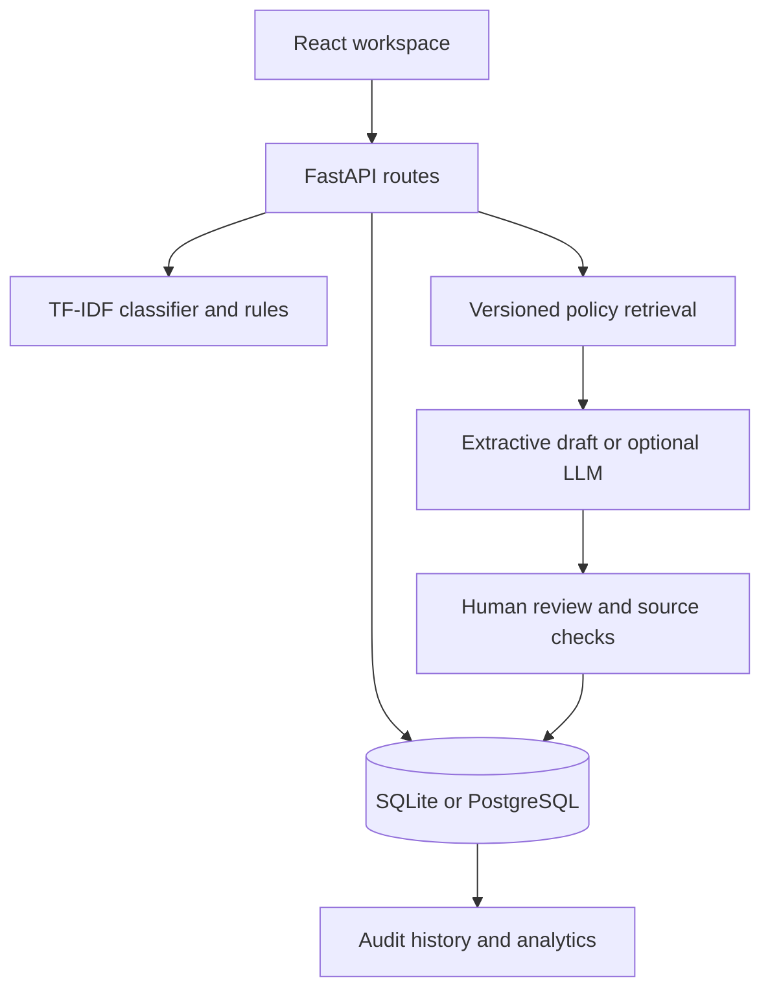
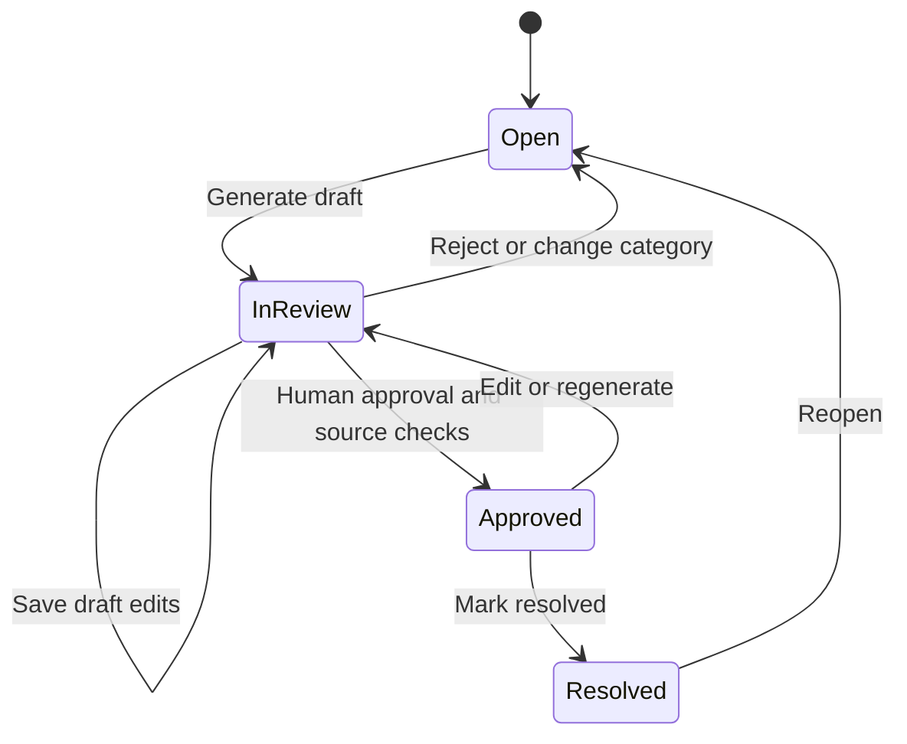

# Architecture and design decisions

SupportIQ is a synchronous, single-workspace application. The browser calls a versioned REST API. The API stores workflow state in SQL and applies lightweight local NLP. Optional LLM drafting happens only when an agent explicitly requests a draft.

## Request flow

1. Pydantic validates complaint size, channel, and allowed fields. Arbitrary workflow fields cannot be injected into ticket creation.
2. Best-effort redaction removes some identifiers before classification. The full complaint remains in the local database because the agent needs to review it; this is not an anonymized datastore.
3. A TF-IDF pipeline predicts a category. Below-threshold scores become `other`; the suggested category and scores remain visible. Urgency and sentiment are separate heuristics.
4. A ticket and `created` audit event are committed. All timestamps represent UTC. A review deadline is computed from the configured priority rules.
5. Explicit draft generation retrieves active policy paragraphs using TF-IDF cosine similarity, a minimum relevance threshold, and at least two shared non-generic terms. Category agreement is a small ranking bonus, never enough to create a match by itself.
6. Each result snapshots policy ID, version, paragraph ID, excerpt, title, source, and similarity. The no-key mode copies at most two excerpts into a draft; optional LLM mode receives the selected evidence.
7. The reviewer compares the draft with those excerpts. A draft is never sent. Approval requires valid citation IDs and policies that are still active at the same version.
8. The approved record may be marked resolved. Reopening removes approval. Editing a response requires a new review.

## Data model

| Table | Purpose | Relationships |
| --- | --- | --- |
| `tickets` | Complaint, routing, model analysis, SLA, draft, approval, version | One-to-many audit events |
| `policies` | Active knowledge text and version | Referenced by draft citation snapshots |
| `audit_events` | Actor label, action, details, timestamp | Foreign key to a ticket |

JSON columns work in both SQLite and PostgreSQL. Audit events are append-only through the application API; they are not a tamper-proof ledger. Reviewer names are operator-supplied labels, not authenticated personal identities.

## State transitions

Category changes clear the existing draft because the relevant source set may change. Priority changes update the review deadline relative to the original creation time, so rerouting does not silently extend the ticket's age.

## Concurrency

Every ticket and policy has an integer version. Mutations carry `expected_version`; stale clients receive HTTP 409. SQLAlchemy also includes the version in the update condition, so checking a version in application code is not the only defense. In PostgreSQL, approval holds shared locks on cited policies through the ticket update. The reviewer must regenerate if a cited policy has changed.

All events for a mutation are committed in the same transaction as that mutation. There is no background queue and no durable job system. Draft generation is a bounded synchronous call. For higher load, move it into a queue with job IDs and cancellation.

## Why these choices?

- **TF-IDF + logistic regression:** fast on a CPU, transparent, measurable, and a useful baseline before adding expensive models. This matches the learning scope of a student portfolio.
- **Lexical retrieval first:** no embedding downloads, external index, or GPU. It is easy to inspect but weak on synonyms and paraphrases.
- **SQL for workflow:** ticket transitions and audits need transactions more than they need a document database.
- **SQLite for local setup / PostgreSQL for containers:** easy onboarding while preserving a deployment path. Migration parity is checked separately.
- **Extractive drafting by default:** the complete review experience is reproducible without credentials. LLM synthesis is an optional extension.
- **Human review:** lexical similarity and valid citations do not establish factual support for every generated sentence.

## Known scaling and product limits

The retrieval index is built per request, analytics scan tickets in memory, and everything runs in one workspace. Suitable next steps are cached versioned indexes, SQL aggregate queries, a job queue, OIDC with roles, per-tenant authorization, retention controls, structured claim verification, metrics, and load testing. Do not claim these are implemented.
